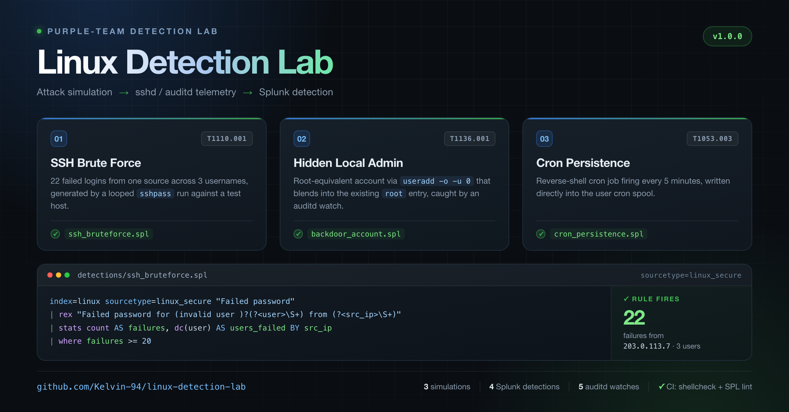

# Linux Detection Lab

[](https://github.com/Kelvin-94/linux-detection-lab/actions/workflows/lint.yml)

Purple-team lab that simulates common Linux attack techniques and validates
Splunk detection rules against them. Every simulation maps to MITRE ATT&CK.

> For authorized test environments only. Never run these simulations against
> systems you do not own or have explicit written permission to test.



## What's inside

| Simulation | Technique | ATT&CK | Detection |
|---|---|---|---|
| 20 failed SSH logins | Brute force | T1110.001 | `detections/ssh_bruteforce.spl` |
| UID-0 backdoor account | Create account | T1136.001 | `detections/backdoor_account.spl` |
| Reverse-shell cron job | Scheduled task | T1053.003 | `detections/cron_persistence.spl` |

## Requirements

- Linux target host (Debian/RHEL) with `auditd`
- Splunk (or Splunk ES) with `linux_secure` and `auditd` sourcetypes ingested
- Attacker box: `sshpass` (`apt install sshpass`)

## Usage

1. Load auditd watches:
   ```bash
   sudo cp auditd/auditd.rules /etc/audit/rules.d/
   sudo augenrules --load
   ```
2. Run a simulation from `simulations/` against your test host.
3. Verify the matching Splunk saved search fires.

Run `simulations/cleanup.sh` when finished.

## Deployment notes

- Save each `.spl` as a Scheduled Search (Settings → Searches, reports, and
  alerts), trigger on `results > 0`.
- Tuning: internet-facing SSH hosts see constant noise — raise the threshold or
  whitelist known scanners before enabling Rule 1 in production.

## Repository layout

```
linux-detection-lab/
├── .github/workflows/lint.yml      # CI: shellcheck + SPL sanity check
├── simulations/                    # attack simulations (one per ATT&CK technique)
├── detections/                     # Splunk saved searches (.spl)
├── screenshots/                    # synthetic sample logs + expected output
├── scripts/
│   └── lint_spl.sh                 # SPL sanity checker used by CI
├── auditd/
│   └── auditd.rules
├── docs/
│   ├── ATT&CK-mapping.md
│   ├── launch-post.md
│   └── assets/lab-overview.png
├── CONTRIBUTING.md
├── LICENSE
└── README.md
```

## Screenshots & sample output

See [`screenshots/`](screenshots/) for synthetic sample log data and the
expected Splunk output for each rule. These are documentation samples, not
captures from a live deployment — real-environment PNGs are welcome via PR.

## Contributing

See [CONTRIBUTING.md](CONTRIBUTING.md). CI runs shellcheck and an SPL sanity
check on every push.

## License

MIT — see [LICENSE](LICENSE).
